  

  

### `> whoami`

Frontend odaklı bir yazılım mühendisiyim. React.js ekosisteminde (Next.js, Zustand,
React Query) ölçeklenebilir ve performanslı arayüzler geliştiriyorum; component
mimarisi, state yönetimi ve uygulama optimizasyonu en çok kafa yorduğum konular.

Backend tarafında Node.js ve Express.js ile API geliştirme, veri modelleme ve
kimlik doğrulama/yetkilendirme üzerine deneyim kazanıyorum. Clean code ve SOLID
prensipleriyle okunabilir, sürdürülebilir kod yazmayı; kullanıcı deneyimini her
kararın merkezinde tutmayı önemsiyorum.

  

### `> ls ./projects`

<table>
  <tr>
    <td width="50%" valign="top">
      <a href="https://github.com/gamzesirin/codetarz"><b>codetarz</b></a> 
      Kod parçalarından saniyeler içinde şık ekran görüntüleri üreten açık kaynak araç. 
      <code>Next.js</code> <code>TypeScript</code> <code>Tailwind CSS</code>
    </td>
    <td width="50%" valign="top">
      <a href="https://github.com/gamzesirin/Commit-Message-Helper"><b>Commit-Message-Helper</b></a> 
      Conventional Commits standardına uygun commit mesajları oluşturan web uygulaması. 
      <code>Next.js</code> <code>React Hook Form</code> <code>Zod</code>
    </td>
  </tr>
  <tr>
    <td width="50%" valign="top">
      <a href="https://github.com/gamzesirin/npm-finder"><b>npm-finder</b></a> 
      NPM paketlerinin metriklerini, bağımlılıklarını ve alternatiflerini karşılaştırma aracı. 
      <code>Next.js</code> <code>TypeScript</code> · <a href="https://npmfinder.com">npmfinder.com</a>
    </td>
    <td width="50%" valign="top">
      <a href="https://github.com/gamzesirin/MCP-News-Server"><b>MCP-News-Server</b></a> 
      Türkçe haber kaynaklarından haber toplayan, özetleyen ve analiz eden MCP sunucusu. 
      <code>TypeScript</code> <code>MCP</code> <code>NLP</code>
    </td>
  </tr>
</table>

### `> cat ./links`

  
  
  

  

